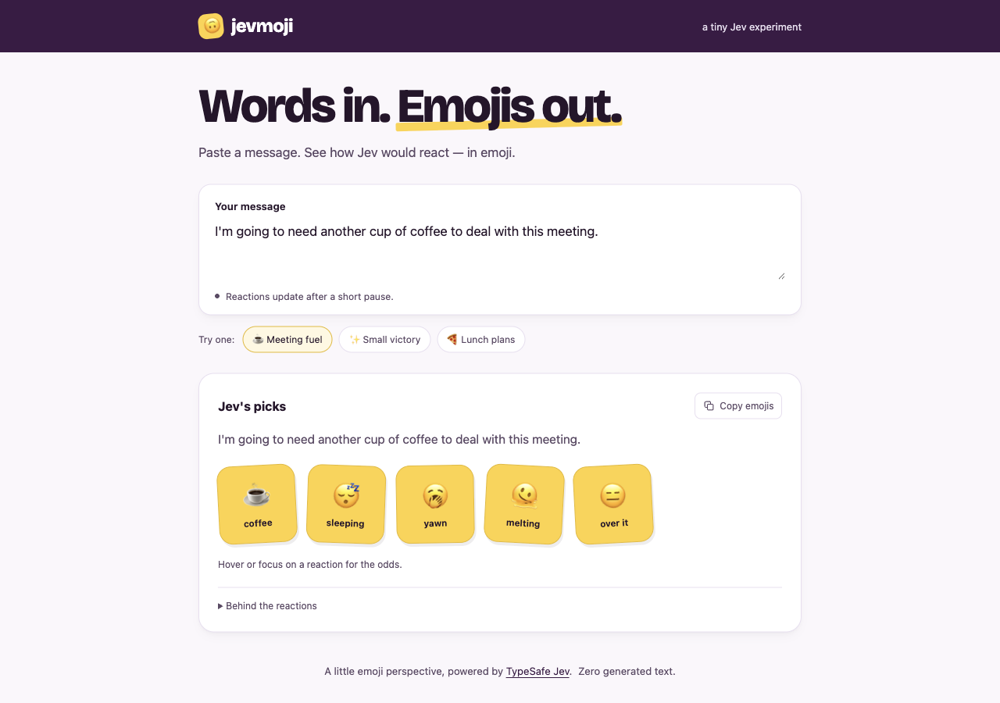

# jevmoji [](https://github.com/amscotti/jevmoji/actions/workflows/ci.yml)

Type a line of group-chat banter, get emoji reactions back. A tiny fun app
powered by [TypeSafe's Jev](https://docs.typesafe.ai) decision model: every
emoji in the catalog is scored as "would this be a natural, fitting reply to this
message?" and the high-probability ones land on your message like Slack
reactions. It is an example integration of the Jev API — one `state` plus one
[Noul](https://docs.typesafe.ai/primitives/noul) question per emoji, evaluated in a single
`POST /v1/systemone` call.



## How it works

You type, pause, and HTMX swaps in the results: the server scores all 200
catalog emojis in one Jev call. The request uses the `jev-latest` alias, so
it tracks TypeSafe's newest stable model — Jev 1.14 (`jev-1.14.0`) as of
October 2026; the exact model that answered appears under "Behind the
reactions." The strongest four can qualify at 50% or higher; a fifth appears
only if its score reaches 75%. The scores are Jev's estimated probabilities
that each emoji fits the message. Reactions are read-only stickers. Blank
input stays idle; anything else — even a "hi" — gets judged. The catalog
covers greetings, appreciation, celebrations, everyday emotions, work, food,
and playful reactions.

## Run

Requires a TypeSafe API key (https://console.typesafe.ai/settings/keys).

```sh
mise install          # go + golangci-lint (+ gcloud for Cloud Run deploys)
cp .env.example .env  # paste your TYPESAFE_API_KEY
mise run build        # produces ./jevmoji — the whole app
./jevmoji -addr :8080 # open http://localhost:8080
```

### Docker

```sh
docker build -t jevmoji:local .
docker run --rm --env-file .env -p 8080:8080 jevmoji:local
```

Open http://localhost:8080. The multi-stage build compiles a static, stripped
Linux executable and puts it in a `scratch` image with the HTTPS CA bundle
and MIT license (about 9–10 MB uncompressed on ARM64/AMD64). It runs as a
non-root user; the HTML, CSS, and JavaScript
are embedded in the executable. Supply `TYPESAFE_API_KEY` at runtime through
`--env-file` or `-e TYPESAFE_API_KEY`; `.env` files are excluded from the build.

To use another port:

```sh
docker run --rm --env-file .env -p 9000:9000 jevmoji:local -addr :9000
```

Buildx also supports `--platform linux/amd64` or `--platform linux/arm64`;
the Go build cross-compiles for the selected target.

### Google Cloud Run

The same container deploys to Cloud Run (scale-to-zero, so an idle demo
costs nothing beyond the always-free allowance):

```sh
gcloud run deploy jevmoji \
  --source=. \
  --region=us-central1 \
  --allow-unauthenticated \
  --set-secrets=TYPESAFE_API_KEY=typesafe-api-key:latest \
  --memory=256Mi --cpu=1 --max-instances=2
```

Prerequisites, one time per project: enable the Cloud Run, Cloud Build,
Artifact Registry, and Secret Manager APIs; store the key with
`gcloud secrets create typesafe-api-key --data-file=-`; and grant the
runtime service account `roles/secretmanager.secretAccessor` on it.
The health endpoint is `GET /health` — Cloud Run's frontend reserves
paths ending in `z` (like `/healthz`) and intercepts them with its own 404.

## Configuration

| Variable | Required | Description |
|---|---|---|
| `TYPESAFE_API_KEY` | yes | TypeSafe API key. Set it in the environment, or in a `.env` file in the working directory or next to the binary (the environment always wins). |
| `-addr` | no | HTTP listen address (default `:8080`). |

Without a key the page still serves, but `/api/reactions` answers 502 with a
hint to check the key. Open Props and HTMX load from pinned CDN URLs with
subresource-integrity hashes; the display font comes from Google Fonts.

## Develop

```sh
mise run fmt    # gofmt
mise run lint   # golangci-lint
mise run test   # go test -race ./...
mise run build  # single-binary build
mise run start  # run from source
```

Pushes and pull requests run the same checks in GitHub Actions
([`ci.yml`](.github/workflows/ci.yml): gofmt, vet, tests with `-race`,
build, golangci-lint, and a container build/startup smoke test). The toolchain
is Go 1.27.1 and golangci-lint 2.14.0.

Frontend is no-build by design: [Open Props](https://open-props.style) tokens
and HTMX 4 for the debounced reactions swap — both pinned on CDNs with
subresource-integrity hashes. Reactions stay read-only, with their model
probabilities available on hover or keyboard focus. Try a sample message,
copy the chosen emojis, or expand the model details. Our template, `app.css`,
and the small `ui.js` helper embed with `go:embed`.

## API

- `GET /` — the page
- `POST /api/reactions` — body `text=<message>` (form) or `{"text":"..."}`
  (JSON). Returns the reactions partial as HTML, or the JSON envelope with
  `?format=json`.
- `GET /health` — `ok` (not `/healthz`: Cloud Run's frontend reserves paths ending in `z`)

## Layout

- `cmd/jevmoji` — flags, `.env` fallback loader, server start
- `internal/jev` — typed TypeSafe System One client (Noul/choice/score answers)
- `internal/catalog` — 200 everyday and playful emojis, with one Noul question each
- `internal/suggest` — sorted reactions: top four at ≥ 50%, an extra fifth at ≥ 75%
- `internal/server` — routes, handlers, embedded assets
- `web/` — the template, CSS, and small UI helper, embedded via `go:embed`
- `Dockerfile` — static Go build and minimal `scratch` runtime

## License

MIT — see [LICENSE](LICENSE).
